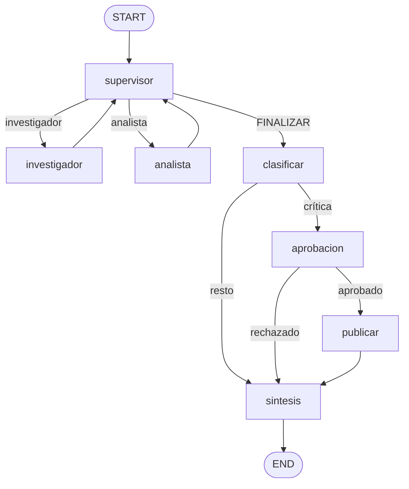

# Pre-entrega 7: API de producción del orquestador

La API recibe una consulta sobre el Nova X, la encola y devuelve un `job_id`. Un worker corre el orquestador del módulo 6: el investigador busca en el índice local, el analista calcula sentimiento y margen, y la síntesis cierra. El estado del job y los checkpoints del grafo viven en Redis. Cada corrida manda trazas a Phoenix. Si la consulta pide publicar un precio en el catálogo, el grafo se detiene hasta un `POST /tasks/{id}/approve`.

## Grafo



`publicar` llama a `publicar_ajuste_precio`, que escribe en `data/ajustes.jsonl`. Esa herramienta no corre hasta que llega la aprobación. El resto de las consultas sigue de `clasificar` a `sintesis`.

## Cómo levantarlo

**Ollama en el host + Redis/Phoenix/API en Docker.** En Windows, Ollama nativo acelera con GPU/DirectML/Vulkan. El mismo `qwen2.5:14b` dentro de Docker (sin NVIDIA) corre en CPU puro: una corrida que en local tarda segundos puede demorar muchos minutos y saturar la máquina.

Desde esta carpeta:

```powershell
# 1) Ollama nativo (puerto 11434) + modelos
.\.venv\Scripts\python.exe levantar.py
# o: ollama serve  /  ollama pull qwen2.5:14b  /  ollama pull all-minilm

# 2) Redis, Phoenix y la API
docker compose up --build -d
docker compose logs -f api
```

Cuando la API responde:

| Servicio | URL |
| --- | --- |
| API (Swagger) | http://127.0.0.1:8000/docs |
| Phoenix | http://127.0.0.1:6006 |
| Ollama (host) | http://127.0.0.1:11434 |
| Redis | `localhost:6379` |

La API en el contenedor habla con Ollama del host por `host.docker.internal:11434` (Compose lo fuerza; no uses `127.0.0.1` dentro del contenedor).

Para bajar Docker: `docker compose down`. Phoenix y Redis quedan en volúmenes nombrados.

### Ollama también en Docker (opcional, lento en CPU)

Solo si tenés GPU NVIDIA passthrough o aceptás CPU:

```powershell
$env:OLLAMA_BASE_URL = "http://ollama:11434"
docker compose --profile ollama-docker up --build -d
```

### Solo API en el host

```powershell
docker compose up -d redis phoenix
.\.venv\Scripts\python.exe -m uvicorn app.main:app --host 127.0.0.1 --port 8000
```

## Cinco peticiones concurrentes

Con la API ya en marcha (`docker compose up` o uvicorn local), en otra terminal:

```powershell
py -3.12 -m venv .venv
.\.venv\Scripts\python.exe -m pip install httpx
.\.venv\Scripts\python.exe correr_carga.py
```

El script manda las cinco consultas juntas, espera a que terminen y después manda una sexta que pide publicar un descuento. Esa se detiene en `AWAITING_APPROVAL`; el script la aprueba y espera el `DONE`. El informe queda en `trazas/carga.json`.

En Phoenix, el proyecto `pre-entrega7` muestra el span `orquestador.consulta` de cada una. Las capturas de esa corrida están en `screenshots/`:

| Archivo | Qué muestra |
| --- | --- |
| `01-trazas-orquestador-consulta.png` | Spans activos del orquestador |
| `02-latencia-p95-y-costos.png` | Gráfico **Trace latency** con la curva **P95** |
| `03-costo-por-ejecucion.png` | Tabla de spans con **Cumulative cost** por ejecución |

La columna de costo sale de los tokens de entrada y salida. Ollama no trae tarifa, así que al arrancar la API se registra en Phoenix una tarifa de referencia para `qwen2.5:14b` (`COSTO_ENTRADA_POR_MILLON` y `COSTO_SALIDA_POR_MILLON` en `.env.example`). Phoenix calcula el monto. Un resumen numérico queda en `trazas/phoenix_resumen.json`.

## API

| Método | Ruta | Qué hace |
| --- | --- | --- |
| `GET` | `/health` | Estado de la API y de Redis |
| `POST` | `/tasks` | Encola la consulta y devuelve `job_id` |
| `GET` | `/tasks/{job_id}` | `PENDING`, `RUNNING`, `AWAITING_APPROVAL`, `DONE` o `FAILED` |
| `POST` | `/tasks/{job_id}/approve` | Reanuda una tarea crítica. Cuerpo: `{"aprobado": true}` |
| `GET` | `/conversations/{thread_id}` | Checkpoint del hilo en Redis |

`POST /tasks` no espera al modelo. Si el worker lanza una excepción, el job pasa a `FAILED` y el cliente deja de hacer polling.

Ejemplo de una consulta que no toca el catálogo:

```powershell
Invoke-RestMethod -Method Post -Uri http://127.0.0.1:8000/tasks -ContentType "application/json" -Body '{"consulta":"Sentimiento y margen del Nova X","thread_id":"demo-1"}'
```

Ejemplo de una consulta crítica. El `GET` queda en `AWAITING_APPROVAL` con la propuesta de precio, y el ajuste se escribe solo después del approve:

```powershell
$alta = Invoke-RestMethod -Method Post -Uri http://127.0.0.1:8000/tasks -ContentType "application/json" -Body '{"consulta":"Publicá en el catálogo un descuento del Nova X"}'
Invoke-RestMethod -Method Post -Uri "http://127.0.0.1:8000/tasks/$($alta.job_id)/approve" -ContentType "application/json" -Body '{"aprobado": true, "comentario": "ok"}'
```

## Piezas

| Archivo | Rol |
| --- | --- |
| `app/main.py` | FastAPI. Encola y consulta estado sin correr el grafo en el request |
| `app/graph.py` | Supervisor, rúbrica, síntesis y `AsyncRedisSaver` |
| `app/worker.py` | Consume la cola y pasa el job a `RUNNING`, `AWAITING_APPROVAL`, `DONE` o `FAILED` |
| `app/hitl.py` | Detecta la publicación en el catálogo, hace `interrupt` y escribe el ajuste si hubo aprobación |
| `app/observability.py` | Phoenix, OpenInference y la tarifa de tokens |
| `app/agents/` | Investigador y analista del módulo 6 |
| `data/corpus.json` | Reseñas y ficha del Nova X |
| `docker-compose.yml` | Redis + Phoenix + API; Ollama en Docker solo con `--profile ollama-docker` |
| `levantar.py` | Arranca Ollama (y Phoenix) en el host si no están |
| `correr_carga.py` | Las cinco peticiones concurrentes y la aprobación |
| `probar_infra.py` | Pausa, reanudación y `FAILED` contra Redis, sin el modelo |

## Configuración

Los modelos, las URLs y la tarifa salen de variables de entorno. `.env.example` lista los valores. Copiá a `.env` para secretos (no se sube al repo).

### Gemini (chat) + Ollama (embeddings)

El chat puede ir a Google Gemini; la búsqueda vectorial local sigue usando embeddings de Ollama (`all-minilm`). En `.env`:

```env
LLM_PROVIDER=gemini
GOOGLE_API_KEY=tu_clave
GEMINI_MODEL=gemini-2.0-flash
```

Con `LLM_PROVIDER=ollama` (default) el chat vuelve a `qwen2.5:14b`.

Para Compose con Gemini, asegurate de tener `.env` en esta carpeta y después:

```powershell
docker compose up --build -d
```
